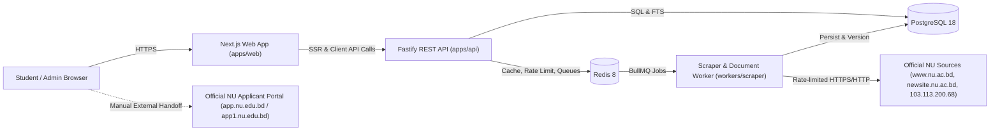

# NP-NU System Architecture

## 1. Overview

NP-NU (**National University Fast Admission & Academic Platform**) is an independent full-stack TypeScript platform built as a monorepo with clear separation between public presentation, API services, background scraping/document workers, PostgreSQL persistence, and Redis caching/queues.



## 2. Monorepo Structure

```text
NP-NU/
├── apps/
│   ├── api/                 # Fastify v5 REST API, auth, migrations, OpenAPI
│   └── web/                 # Next.js App Router frontend (public, student, admin)
├── packages/
│   ├── shared/              # Bengali normalization, date parsing, hashing, eligibility engine
│   └── schemas/             # Shared Zod schemas & TypeScript domain types
├── workers/
│   └── scraper/             # BullMQ worker: official NU adapters, PDF extractor, change detector
├── infra/
│   ├── docker/              # Dockerfiles & Nginx staging config
│   └── render/              # Render Blueprint (render.yaml)
├── docs/                    # Architecture, NU website analysis, API, DB, deployment docs
└── tests/                   # Unit, integration, scraper-fixture, API, and E2E tests
```

## 3. Security & Provenance Boundaries

1. **Strict Official-Source Only:** Scraper adapters only fetch from validated NU domains (`www.nu.ac.bd`, `newsite.nu.ac.bd`, `results.nu.ac.bd`, `103.113.200.68`) respecting `robots.txt`.
2. **No Automated Portal Submission:** `app.nu.edu.bd` and `app1.nu.edu.bd` are external handoff destinations only. NP-NU never stores NU passwords, never bypasses CAPTCHAs, and never submits applications or payments on a student's behalf.
3. **Verification State Machine:** Scraped notices/circulars carry `VERIFIED | UNVERIFIED | STALE | SUPERSEDED | FAILED | NEEDS_REVIEW`. Missing fields remain `null` and are rendered as `"Information unavailable"`—never fabricated.
4. **Student Data Isolation:** Student profiles, drafts, preferences, and tracking events are strictly isolated by authenticated `user_id` ownership checks and excluded from public APIs.
